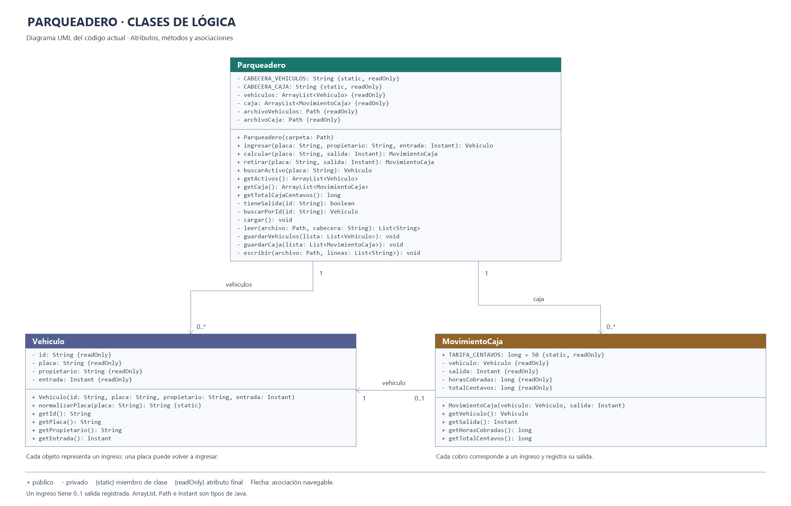

# Parqueadero

Aplicación de escritorio en Java Swing para registrar el ingreso y la salida de vehículos de un parqueadero. Interfaz editable con Eclipse WindowBuilder.

## Funciones

- Registro de placa, propietario opcional y fecha/hora de ingreso.
- Consulta de los vehículos que permanecen dentro del parqueadero.
- Cálculo del valor a pagar a **$0,50 por hora o fracción**, con un mínimo de $0,50.
- Confirmación del cobro y registro de la salida.
- Historial de salidas y total acumulado en caja.
- Almacenamiento automático en archivos de texto y recuperación al iniciar.

## Requisitos

- Java 8 o superior.
- Eclipse con soporte Java; WindowBuilder para editar visualmente la pantalla.
- No requiere librerías externas ni base de datos.

## Abrir y ejecutar en Eclipse

1. Clonar o descargar este repositorio.
2. Seleccionar **File > Import > General > Existing Projects into Workspace**.
3. Elegir la carpeta del repositorio e importar el proyecto `Parqueadero`.
4. Abrir `src/parqueadero/VentanaParqueadero.java`.
5. Seleccionar **Run As > Java Application**.

Para editar la interfaz: clic derecho sobre `VentanaParqueadero.java` > **Open With > WindowBuilder Editor** > pestaña **Design**.

## Clases

| Clase | Responsabilidad |
|---|---|
| `Vehiculo` | Datos de cada ingreso: ID, placa, propietario y fecha de entrada. |
| `MovimientoCaja` | Fecha de salida, horas cobradas y valor exacto en centavos. |
| `Parqueadero` | Gestión de las listas, validaciones y lectura/escritura de archivos. |
| `VentanaParqueadero` | Interfaz Swing, eventos y método `main`. |

## Persistencia

Al ejecutar el programa se crea automáticamente la carpeta `datos/` dentro del directorio de ejecución:

- `vehiculos.txt`: historial de ingresos, con ID, placa, propietario y fecha de entrada.
- `caja.txt`: salidas y cobros, vinculados al ID del ingreso.

Los archivos usan UTF-8, columnas separadas por tabulaciones y fechas ISO en UTC. La interfaz muestra las fechas en la zona horaria del equipo. Un ingreso está activo mientras no tenga salida en caja.

La carpeta `datos/` se excluye del repositorio para que cada instalación mantenga sus propios registros. Usar una sola instancia del programa sobre la misma carpeta de datos.

## Ejemplos de cobro

| Tiempo | Valor |
|---|---:|
| 10 minutos | $0,50 |
| 1 hora exacta | $0,50 |
| 1 hora y 1 minuto | $1,00 |
| 2 horas exactas | $1,00 |

## Diagrama UML

El diagrama representa las tres clases de lógica; la interfaz gráfica se omite.

[Abrir el archivo editable de draw.io](docs/Diagrama-Parqueadero.drawio)
